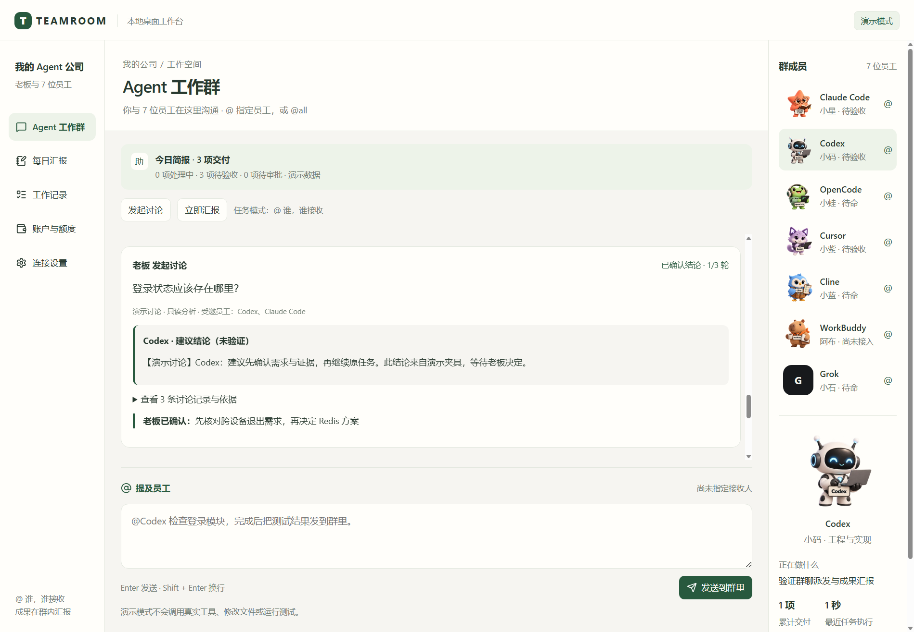
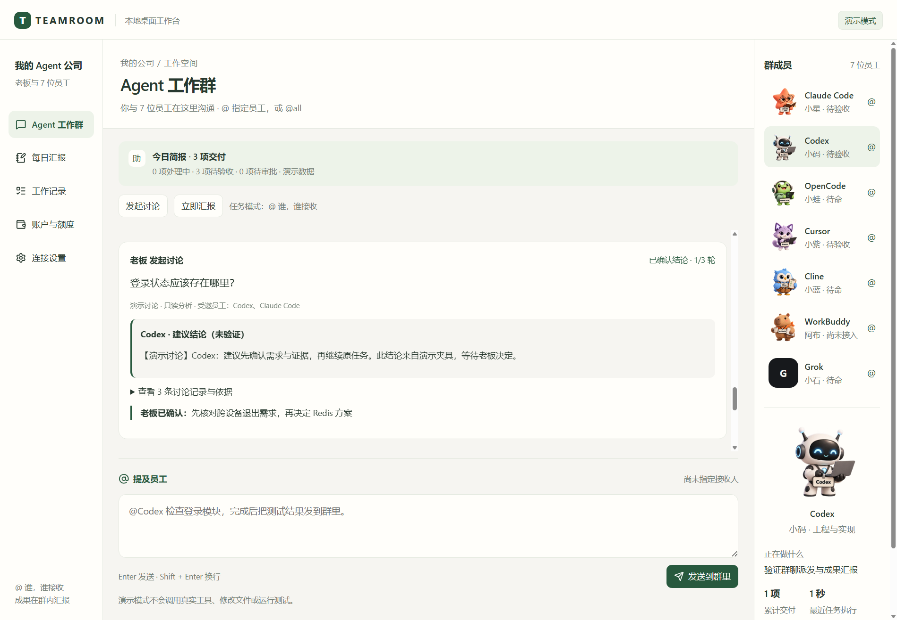

# Teamroom

**Your AI agents, in one local desktop group chat.**

给本地 AI 工具建一个工作群。你是老板，Agent 是带着产品名牌的卡通员工：在群里 @ 指定员工交代工作，他们在群里回复进展与成果。



## 当前版本：0.1.0 开发预览

- Electron + React + TypeScript 桌面应用，沿用已确认的群聊设计。
- `@Claude Code`、`@Codex` 等产品名识别、多人 @、接收人去重与整体预检查。
- 显式 `@all` 只广播给当前可用员工；显式 @ 到不可用员工仍会阻止整条发送。
- SQLite 保存群消息、任务、模式和工作目录；重复消息 ID 不会重复派发。
- 真实 **Codex App Server** 接入：流式回复、会话续接、命令/文件审批、取消和额度查询。
- 本机安装发现：Codex 与 Grok 检测到 CLI 后才可派发；其他工具显示已安装但未接入。
- 演示模式支持除 WorkBuddy 外的员工，不调用真实模型；WorkBuddy 始终标明待接入。Grok 为实验性适配器，只有协议夹具验证。
- 工具完成与老板验收分开；失败、中断、取消保留在记录里。
- 默认只读；修改项目文件需在连接设置中明确启用目录写入，并继续遵守 Codex 审批。
- 主动汇报：默认每 30 分钟有状态变化才发送、北京时间 18:00 日报、手动立即汇报；本地生成，不额外调用模型。
- 群内讨论：老板 @ 最多两位可用员工发起问题，Agent 也可在工具轮次结束时提出结构化问题；最多三轮，只读咨询，结论经老板确认后明确继续原任务。
- 关闭窗口驻留托盘；完成、失败、审批和讨论待决可以桌面提醒，休眠/重启后合并补报且不自动重放任务。

| 工具 | 演示 | 真实适配器 |
|---|---|---|
| Codex | 支持 | v0.1 已实现（受支持） |
| Grok | 支持 | 实验性；协议夹具通过，真实 CLI/账户未验证 |
| Claude Code | 支持 | M3 |
| OpenCode | 支持 | M3 |
| Cursor | 支持 | M4 |
| Cline | 支持 | M4 |
| WorkBuddy | 待接入 | M4 接口评估后决定能力范围 |

**这些卡通形象是原创概念设计，并非对应厂商的官方吉祥物。** 产品名称及商标归各自权利人所有。

## 本地运行

需要 Node.js 22.16+、npm 和 Git。

```sh
git clone https://github.com/frankxiaofei/agent-teamroom.git
cd agent-teamroom
npm ci
npm run dev
```

发布构建后的源码运行：

```sh
npm run build
npm start
```

浏览器只看演示：`npm run web`。浏览器演示使用 LocalStorage；真实工具和 SQLite 仅在桌面运行。

## 连接真实 Codex

1. 通过 [Codex 官方文档](https://learn.chatgpt.com/docs/app-server) 安装 CLI，并在外部终端完成登录。
2. 在 Teamroom 的「连接设置」选择真实模式和一个本地项目目录。
3. 保持只读进行首次验证；需要改代码时再启用「允许修改工作目录中的文件」。
4. 在群里输入 `@Codex 阅读项目说明，汇报你理解的结构`。

如果尚未选择工作目录，首次发送会弹出目录选择框，选定后自动保存并发送；取消选择会保留消息草稿。也可以使用群聊输入框下方的「选择工作目录 / 切换工作目录」。已选目录被删除或无法访问时，重新选择后再次发送。

不需要把 API key 或登录文件交给 Teamroom。它复用 CLI 自己的认证方式。检测到 CLI 只证明已安装；模型、登录和额度是否可用以实际请求为准。

真实模式也会识别本机已安装的其他 Agent 命令，但只有存在执行适配器的员工可以接收任务。Grok 适配器目前只通过协议夹具验证，尚未在本机完成真实 CLI/账户验证；检测到 `grok` 命令不等于已验证可用。@all 只展开到当前可用员工。

## 工作记录与能力边界

### 主动汇报与群内讨论

群聊上方点击「发起讨论」，在同一个输入框中 @ 最多两位员工并填写问题；发送的是讨论邀请，不会创建修改代码的执行任务。可以从任务卡片的「就此发起讨论」关联原任务。回复与建议总结聚合在问题卡片中，老板可补充意见、继续下一轮或提交结论。



「确认结论，结束讨论」不会执行任务；只有「确认并继续原任务」会把暂停任务重新入队，并保留原任务的工作目录和写入授权。讨论使用新会话、只读权限并拒绝权限扩大请求；讨论一致不表示实现已经通过验证。

真实讨论仅邀请已接入且可用的员工。v0.1 受支持的真实适配器仍只有 Codex；Grok 适配器为实验性，只有协议夹具证据。因此跨产品真实讨论仍依赖 M3/M4；多人演示与测试夹具只用于验证编排，不冒充真实多工具验证。没有其他真实员工可用时，Agent 的问题会明确交给老板决定。

「连接设置 → 主动汇报」可设置检查间隔、日报时刻和桌面提醒。默认北京时间 18:00 汇总前一日 18:00 至当日 18:00；新启用时不补发安装之前的历史日报。关闭窗口后在托盘继续运行，托盘菜单可打开、立即汇报或彻底退出。退出和关机期间无法准时发送，下一次启动合并补报。通知被系统屏蔽时，群内记录仍保留。浏览器版本仅演示卡片，不运行后台定时器。

- 目前只统计由 Teamroom 发起的任务，不接管工具桌面界面里已有的所有聊天。
- 多人 @ 把同一条指令分别交给指定工具，不自动拆解目标或替老板选择员工。
- v0.1 全局串行执行任务，避免多个员工同时覆盖工作目录；后续并行先实现 workspace 隔离。
- 重启后未完成任务标记中断，需检查原工具后再明确发送；不会自动重派。
- 命令和文件变更审批已实现。其他 Codex 交互请求明确返回不支持，不自动批准。
- 账户额度不是余额或账单。没有账单来源时不推断欠费，不把 token 折算当实际消费。
- 当前为源码开发预览，尚无签名安装包、自动更新或稳定版承诺。

## 开发与验证

```sh
npm run verify
npm run smoke:desktop
# 受限/无交互桌面主机：改用工作区数据目录并关闭 Chromium sandbox
# TEAMROOM_SMOKE_NO_SANDBOX=1 TEAMROOM_SMOKE_DATA_DIR=.smoke-data npm run smoke:desktop
node scripts/smoke-codex.mjs
# 可选：会调用已登录 Codex 的一次极小推理请求
node scripts/smoke-codex.mjs --inference
# 可选：两次极小只读调用，验证真实讨论回复与总结
node scripts/smoke-discussion.mjs --inference
```

测试包括接收人边界、`@all` 与安装发现、幂等派发、SQLite 事务与重启、取消、Codex/Grok 子进程协议夹具、主动汇报与群内讨论，以及桌面烟测。夹具测试与真实服务验证分别记录；Grok 不应被描述为已完成真实接入。

## 规划与协作

- [需求清单](docs/requirements.md)
- [Milestones](docs/milestones.md)
- [Tasks](docs/tasks.md)
- [架构与数据边界](docs/architecture.md)
- [X 推荐计划与文案](docs/x-launch.md)
- [形象素材说明](docs/assets.md)
- [本机验证与证据边界](docs/verification.md)

欢迎提交 issue，优先贡献 Claude Code / OpenCode 适配器、ACP 集成和真实使用反馈。
